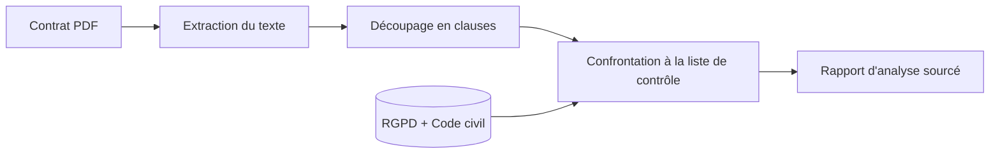
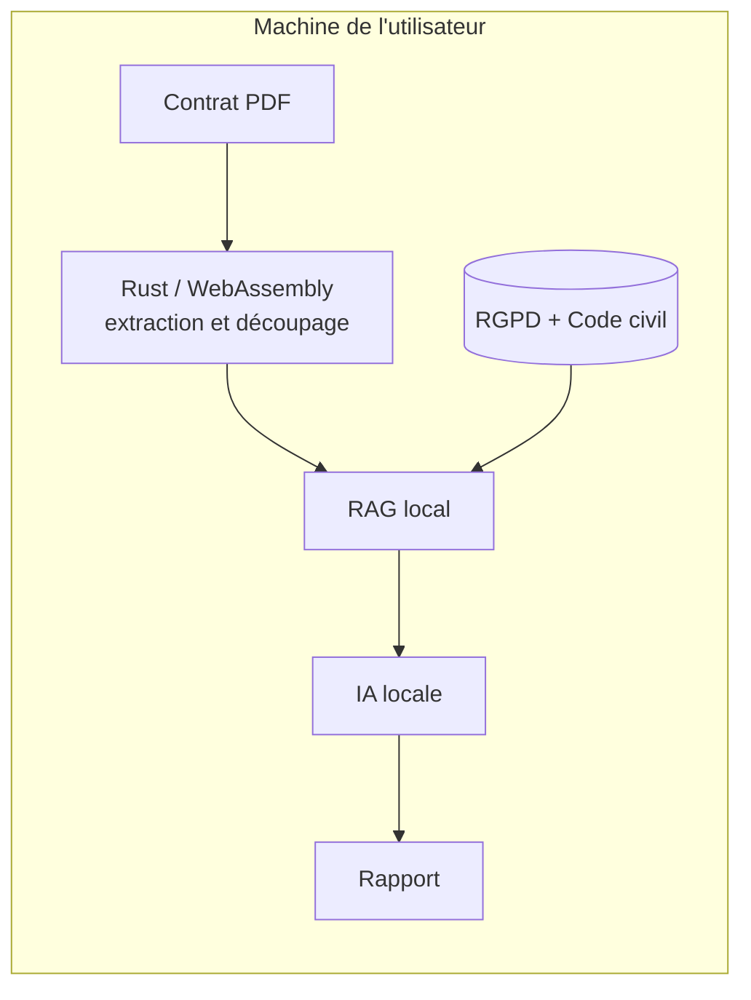

# GDPR Contract Auditor

**Revue de contrats de sous-traitance de données au regard du RGPD, propulsée par l'IA**

[Présentation](#présentation) ·
[Liste de contrôle](#liste-de-contrôle) ·
[Analyse](#analyse) ·
[Sources juridiques](#sources-juridiques) ·
[Interface](#interface) ·
[Privacy by design](#privacy-by-design) ·
[Feuille de route](#feuille-de-route)

---

## Présentation

**GDPR Contract Auditor** analyse un contrat de traitement de données (contrat de sous-traitance, ou *DPA*) et le confronte à une liste d'éléments à vérifier. Pour chaque contrat, l'outil :

- **identifie les clauses manquantes** ;
- **repère les anomalies** : clauses incomplètes, ambiguës, contradictoires ou déséquilibrées ;
- **produit une analyse** clause par clause, en citant les articles concernés.

L'outil repose sur un système de **RAG** (*Retrieval-Augmented Generation*) : chaque constat s'appuie sur les textes de référence et **cite sa source**, ce qui limite les hallucinations.

---

## Liste de contrôle

### Mentions obligatoires - article 28 du RGPD

| | Élément vérifié | Fondement |
|:-:|---|---|
| 1 | Objet, durée, nature et finalité du traitement, type de données et catégories de personnes concernées | Art. 28.3 |
| 2 | Traitement uniquement sur instruction documentée du responsable, y compris pour les transferts hors UE | Art. 28.3 a) |
| 3 | Engagement de confidentialité des personnes autorisées à traiter les données | Art. 28.3 b) |
| 4 | Mesures de sécurité | Art. 28.3 c) et art. 32 |
| 5 | Conditions de recours à un sous-traitant ultérieur | Art. 28.2, 28.3 d) et 28.4 |
| 6 | Aide au responsable pour répondre aux demandes d'exercice des droits | Art. 28.3 e) |
| 7 | Aide au responsable pour la sécurité, la notification des violations et les analyses d'impact | Art. 28.3 f) et art. 32 à 36 |
| 8 | Suppression ou restitution des données en fin de prestation | Art. 28.3 g) |
| 9 | Mise à disposition des informations et possibilité d'audits, y compris d'inspections | Art. 28.3 h) |
| 10 | Information du responsable si une instruction lui semble contraire au RGPD | Art. 28.3, dernier alinéa |

### Clauses complémentaires

| | Élément vérifié | Fondement |
|:-:|---|---|
| 11 | Notification des violations de données au responsable dans les meilleurs délais | Art. 33.2 RGPD |
| 12 | Responsabilité en cas de violation de données : répartition, plafonds, exclusions | Art. 82 RGPD, art. 1231-1 et 1231-3 C. civ. |
| 13 | Validité des clauses limitatives de responsabilité | Art. 1170 et 1171 C. civ. |
| 14 | Transferts de données hors UE et garanties appropriées | Art. 44 à 46 RGPD |

---

## Analyse

Le rapport classe chaque élément de la liste de contrôle :

| Statut | Signification |
|:-:|---|
| ✅ | Clause présente et conforme |
| ⚠️ | Anomalie : clause présente mais incomplète, ambiguë ou déséquilibrée |
| ❌ | Clause manquante |

Pour chaque élément, il indique l'extrait du contrat concerné, le fondement juridique et une recommandation.

**Exemples d'anomalies recherchées :**

- un plafond de responsabilité qui exclut les dommages liés à une violation de données ;
- un délai de notification des violations de 72 heures imposé au sous-traitant, qui ne laisse plus de marge au responsable pour notifier l'autorité de contrôle ;
- un recours à des sous-traitants ultérieurs sans information préalable ni possibilité d'opposition ;
- des audits limités à la simple remise d'un rapport par le sous-traitant ;
- l'absence de règle sur le sort des données en fin de contrat.

---

## Sources juridiques

L'outil s'appuie **uniquement** sur :

- le **RGPD** (règlement (UE) 2016/679) ;
- le **Code civil**, lorsque c'est pertinent :
  - droit commun des contrats (art. 1101 et suivants), notamment la force obligatoire, les clauses limitatives de responsabilité et la réparation du préjudice ;
  - droit des contrats spéciaux, selon la qualification du contrat principal (par exemple le contrat d'entreprise).

---

## Interface

Une interface web en **HTML, CSS et JavaScript** permettra de :

- déposer le contrat à analyser ;
- suivre l'avancement de l'analyse ;
- consulter le rapport, élément par élément, avec les statuts ✅ ⚠️ ❌ et les articles cités.

---

## Privacy by design

Un contrat de sous-traitance contient des informations confidentielles : parties, prix, mesures de sécurité, sous-traitants. L'objectif est donc que **tout tourne en local** et que **le contrat ne quitte jamais la machine de l'utilisateur**, conformément au principe de protection des données dès la conception (art. 25 RGPD).

- **Lecture du contrat dans le navigateur** : l'extraction du texte et le découpage en clauses sont réalisés par une brique **Rust compilée en WebAssembly**, exécutée directement dans le navigateur.
- **IA locale** : le modèle de langage et le modèle d'embeddings du RAG tournent sur la machine de l'utilisateur, sans appel à une API externe.
- **Aucun envoi à un tiers** : ni le contrat ni le rapport ne sont transmis ou conservés sur un serveur.

---

## Feuille de route

- [ ] Constituer le corpus : RGPD et Code civil
- [ ] Extraire le texte du contrat et le découper en clauses (Rust compilé en WebAssembly)
- [ ] Formaliser la liste de contrôle
- [ ] Choisir et intégrer un modèle d'IA local : dans le navigateur (WebGPU) ou via un serveur local
- [ ] Rechercher les passages pertinents et confronter chaque clause (RAG local)
- [ ] Générer le rapport d'analyse
- [ ] Interface web (HTML, CSS, JavaScript) : dépôt du contrat et affichage du rapport

---

## Avertissement

Cet outil est une **aide à l'analyse** et ne constitue **pas un conseil juridique**. Ses résultats doivent être vérifiés par un professionnel qualifié (DPO, juriste, avocat).
